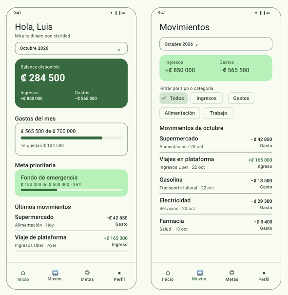
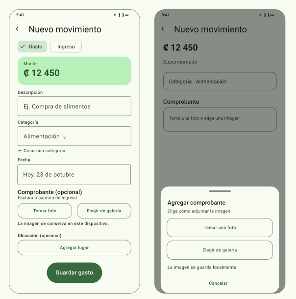
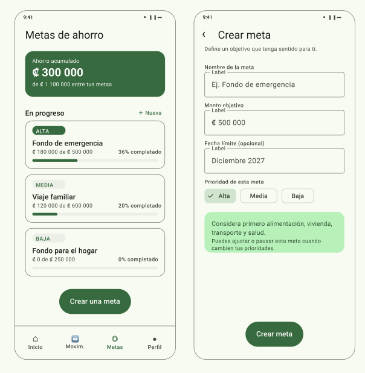
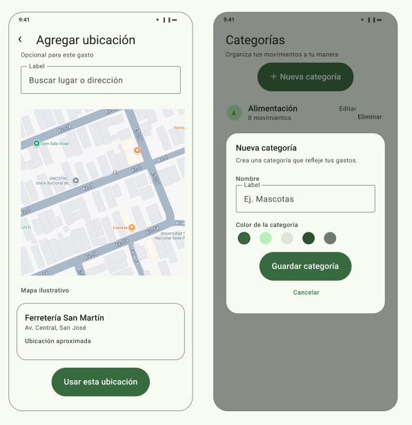

# MyFi — Mis Finanzas

**Entiende adónde va tu dinero y avanza hacia lo que quieres lograr.**

## Descripción

MyFi es una propuesta de aplicación móvil para ayudar a las personas a organizar sus finanzas personales y tomar decisiones más conscientes sobre su dinero. La idea nace de una necesidad propia: llevar un mejor control de los ingresos, los gastos y las metas de ahorro. También busca atender una situación que muchas personas pueden compartir: a veces gastamos sin detenernos a pensar en qué se fue el dinero o qué tan cerca estamos de nuestros objetivos.

La aplicación permitirá registrar ingresos y gastos, revisar los movimientos por periodo y categoría, y establecer metas de ahorro con distintos niveles de prioridad. También facilitará contemplar gastos esenciales, como alimentación, vivienda, transporte y salud, para que cada persona pueda entender mejor cuánto dinero tiene disponible.

MyFi se plantea como una aplicación de uso local: la información financiera se guardará en el dispositivo del usuario y no se enviará a servidores externos. La privacidad será un principio de diseño desde el inicio, junto con el control del usuario sobre la información que registra.

## Funcionalidades propuestas

- **Registro de movimientos:** crear, consultar, editar y eliminar ingresos y gastos.
- **Categorías personalizadas:** utilizar categorías iniciales y crear, editar o eliminar categorías propias para adaptar el registro a las necesidades de cada persona.
- **Filtros de consulta:** buscar movimientos por tipo, categoría y periodo.
- **Metas de ahorro:** definir un monto objetivo, una fecha opcional y la prioridad de cada meta; consultar el avance hacia el objetivo.
- **Resumen financiero:** visualizar ingresos, gastos, balance del periodo y progreso de las metas.
- **Adjuntos para el registro:** asociar una fotografía de una factura o una captura de pantalla a un movimiento. En la propuesta inicial, la imagen sirve de referencia para que el usuario complete o revise los datos antes de guardarlos.
- **Ubicación opcional:** asociar un lugar a un gasto para recordar dónde se realizó una compra.

## Privacidad y crecimiento futuro

La propuesta prioriza el almacenamiento local de los datos financieros y el respeto por la privacidad de las personas. Cualquier ampliación técnica deberá considerar la normativa nacional aplicable sobre protección de datos personales y explicar con claridad qué información se utiliza y para qué.

En futuras etapas, MyFi podría incorporar reconocimiento óptico de caracteres (OCR) para ayudar a leer facturas o capturas de ingresos, así como otras herramientas que reduzcan el trabajo manual. Estas funciones son ideas futuras y no forman parte del alcance inicial; los datos sugeridos por cualquier herramienta automática deberán poder revisarse y corregirse por el usuario.

## Mockups

Los mockups se diseñaron en Figma como capas editables para que el equipo y el profesor puedan revisarlos y proponer cambios.

Propuesta a los cambios; (https://www.figma.com/design/hHnkj28JyvOk5ePe13uL7L/MyFi---Mis-Finanzas-?node-id=0-1&m=dev&t=hA0PTQI3Jt4TCM0r-1)

| Inicio y resumen | Movimientos |
|---|---|
|  |  |

| Registro de movimiento | Metas de ahorro |
|---|---|
|  |  |

Las vistas incluidas son:

1. Inicio y resumen financiero.
2. Movimientos con filtros por tipo y categoría.
3. Registro de un movimiento con categoría, comprobante y ubicación opcional.
4. Diálogo para elegir entre tomar una foto o seleccionar una imagen de la galería.
5. Metas de ahorro con prioridad y avance.
6. Formulario para crear una meta y considerar gastos esenciales.
7. Selección de una ubicación en el mapa.
8. Categorías personalizadas y diálogo para crear una categoría.

## Alcance

Este proyecto documenta la idea, las pantallas propuestas y los avances del desarrollo. La aplicación se desarrollará por etapas, comenzando por las funciones principales de registro, consulta y organización financiera.

## Configuración del repositorio

Se configuró una regla para proteger la rama main y solicitar una revisión antes de integrar cambios mediante Pull Request. Sin embargo, GitHub indica que esta regla no se aplica al repositorio privado con el plan actual de la organización. Por ese motivo, la protección automática de main queda pendiente de habilitar un plan compatible.

